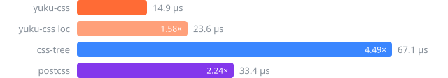

# yuku-css

A fast CSS parser, written in Zig and compiled to WebAssembly, that builds [css-tree](https://github.com/csstree/csstree)'s tree.

```bash
npm install yuku-css
```

## Usage

```ts
import { parse, type Rule } from "yuku-css";

const source = `.card:has(> img) {
  color: red !important;
  &:hover { color: blue }
}`;

const { ast, comments, diagnostics } = parse(source);

const rule = ast.children[0] as Rule;
rule.prelude; // SelectorList of Selector, each of simple selectors and Combinator, as css-tree has them
rule.block.children; // Declaration { important: true, property: "color", value: Raw { value: "red" } }, then Rule
```

It runs in Node.js 18 or newer, Bun, Deno, Workers, and browsers.

The tree is css-tree 3.2.1's, node for node and field for field, with arrays in place of css-tree's `List`. Every node has `start` and `end`, UTF-16 offsets into the source, so `source.slice(node.start, node.end)` is its text. With `positions: true`, each node has css-tree's `loc` instead, with lines and columns. Its nodes are typed in [src/ast.ts](src/ast.ts).

`parse` returns `{ ast, comments, tokens?, diagnostics }`, as Yuku returns `{ program, comments, tokens?, diagnostics }`. `ast` is the node the source is read as: a `StyleSheet`, or with `context` any of css-tree's parse contexts. `comments` holds every comment, in source order.

`parse` never throws on bad CSS. What does not parse is kept as `Raw`, as css-tree keeps it, with a diagnostic in Yuku's shape carrying css-tree's message, so a caller that must reject bad CSS checks `diagnostics.length`. Where the CSS specifications read an error that css-tree does not, such as a comment the source ends in or a selector that starts with a combinator outside `:has()` and nesting, the tree is still css-tree's and a diagnostic reports the error.

### Options

| Option | Default | |
|---|---|---|
| `context` | `"stylesheet"` | read the source as `"atrule"`, `"rule"`, `"selectorList"`, `"selector"`, `"block"`, `"declarationList"` or `"declaration"`; `"atrulePrelude"`, `"mediaQueryList"`, `"mediaQuery"` and `"value"` give a `Raw` for now |
| `positions` | `false` | `loc` in place of `start` and `end` |
| `filename`, `offset`, `line`, `column` | `"<unknown>"`, `0`, `1`, `1` | where `loc` says the source is |
| `tokens` | `false` | keep every token in `tokens`, packed as `tokenize` packs them |
| `onParseError`, `onComment`, `onToken` | | css-tree's callbacks, called after parsing from the result: each diagnostic as a css-tree `SyntaxError`, each comment with its `loc`, each token's type and offsets |
| `parseRulePrelude` | `true` | `false` keeps each selector as `Raw` |
| `parseValue`, `parseAtrulePrelude`, `parseCustomProperty` | `true`, `true`, `false` | accepted, but declaration values and at-rule preludes are `Raw` for now |

### Tokens

```ts
import { tokenize, tokenNames } from "yuku-css";

for (const token of tokenize("a { color: red }")) {
  tokenNames[token >>> 24]; // "ident-token", "whitespace-token", "{-token", …
  token & 0xffffff; // the UTF-16 offset where the token ends
}
```

`tokenize` packs each token as css-tree's `offsetAndType` does, with the 26 token types of `tokenTypes`.

### Printing

```ts
import { generate } from "yuku-css/codegen";

generate(stylesheet); // ".card:has(>img){color:red!important;&:hover{color:blue}}"
generate(stylesheet, { sourceMap: true }); // { css, map }, map.toString() the JSON
```

`yuku-css/codegen` prints css-tree's tree, any of its 49 node types, byte for byte as css-tree's `generate` does, from yuku-css or from css-tree, with arrays or `List`s for children. It takes css-tree's options: `sourceMap`, `mode` (`"safe"`, the default, or `"spec"`, which spaces only the token pairs the CSS Syntax needs spaced), and `decorator`, which wraps css-tree's generator handlers. A source map maps where each `Atrule`, `Selector`, and `Declaration` with a `loc` starts, as css-tree's does.

### Walking

```ts
import { walk, find, clone } from "yuku-css/ast";

walk(stylesheet, {
  visit: "Declaration",
  enter(node) {
    this.rule; // the Rule it is in
  },
});
```

`yuku-css/ast` has the rest of css-tree's API for its tree: `walk` (with `enter`, `leave`, `visit`, `reverse`, and `walk.break` and `walk.skip`), `find`, `findLast`, `findAll`, `clone`, `List`, `fromPlainObject`, `toPlainObject`, `property`, `keyword`, `vendorPrefix`, `isCustomProperty`, and `ident`, `string`, and `url`, each with `encode` and `decode`. A handler's `item` and `list` are the `List` item and `List`, or for an array the index and the array.

### Where it differs from css-tree

Where css-tree reads CSS otherwise than the CSS Syntax, Nesting, and Selectors specifications, yuku-css follows the specifications. Most visibly, css-tree reads a nested rule that does not start with `&`, such as `.a { .b {} }`, as a broken declaration, and reads no column combinator `||`. [test/divergences.ts](test/divergences.ts) lists every difference with the spec it follows and the css-tree fixtures it fails; [test/compare.ts](test/compare.ts) forks css-tree to parse the same way for the parity tests.

css-tree's own fixtures run as the suite, `bun test test/suite.test.ts`, refreshed with `bun run sync`. A fixture of what yuku-css does not build yet, values, at-rule preludes, the generator and the lexer, is listed as pending in the same file and must fail until it lands.

`generate` prints a `Ratio` without a right term as `16/1`, where css-tree throws, and `string.decode` and `url.decode` keep what comes before an escaped closing quote or parenthesis, as in `"ab\"`, where css-tree keeps only the quote.

## Benchmark

Parsing the 252 style sheets of [test/corpus](test/corpus) against [css-tree](https://github.com/csstree/csstree), set to keep values and at-rule preludes raw as yuku-css does and to give positions, and [PostCSS](https://postcss.org), which leaves selectors as strings. `yuku-css loc` parses with `positions: true`, so it builds the very tree css-tree does.



Median time per file over 3 runs, each in a fresh Node.js 24 process on an Apple M5 Pro. Run it with `bun run bench`, `node bench/index.ts tokenize` to time tokenizing, or `node bench/index.ts generate` to time printing css-tree's tree of each file, values parsed:

| generator | per file |
|---|---|
| yuku-css | 10.0 µs |
| css-tree | 18.4 µs |
| yuku-css, with a source map | 23.7 µs |
| css-tree, with a source map | 53.5 µs |

[docs/benchmark.md](docs/benchmark.md) goes further: real-world and synthetic CSS by size, Bun and Chromium, css-tree's defaults, Lightning CSS, cold start, memory, and bundle size. Run it with `bun run bench:full`.

## Development

Needs [Zig](https://ziglang.org) 0.17 and [Bun](https://bun.sh).

```bash
bun install
bun run build      # zig build, which also writes src/decode.js from the Zig layouts, then tsdown
bun run typecheck
bun run test
zig build test     # the Zig tests
bun run corpus     # copies the CSS of a Markless checkout into test/corpus
bun run sync       # copies css-tree's test fixtures into test/csstree, as `bun run test` does
```

The tests check every token, node, position, and error against css-tree on every file of the corpus, the `<style>` blocks and `.css` files of the [Markless](https://github.com/compiled-run/markless) repository, on broken CSS, and on the corpus mutated at random. `generate` is checked against css-tree's on every case of css-tree's fixtures and on the corpus, with and without source maps, and the walker and its kin run css-tree's own tests.

## License

MIT
