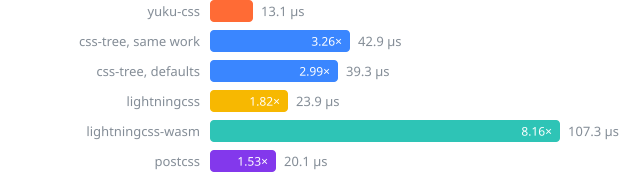
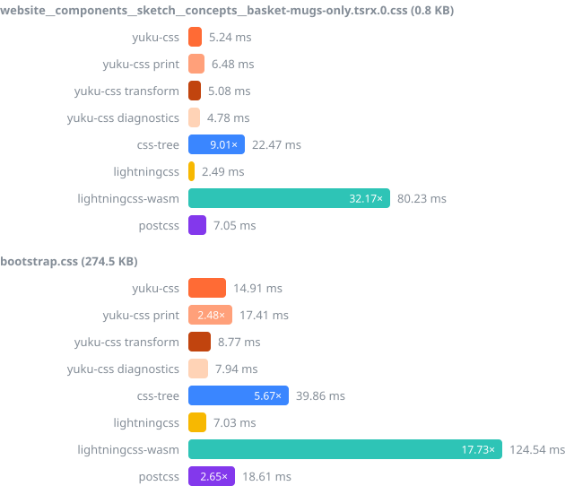

# Benchmark

yuku-css 0.1.0 (85f4f6c) against [Lightning CSS](https://lightningcss.dev) 1.33.0, its fastest rival, and [css-tree](https://github.com/csstree/csstree) 3.2.1, whose tree it builds, with [PostCSS](https://postcss.org) for context, on an Apple M5 Pro, 2026-10-14. Run it with `bun run bench:full`; the raw data is in [bench/results/2026-10-14.json](../bench/results/2026-10-14.json).

## Against Lightning CSS

Lightning CSS returns no tree to JS. Its `transform({ filename, code, minify: false })` parses every value into typed Rust structures and prints CSS back. yuku-css's `transform` does the same in kind: one WebAssembly call parses, values and at-rule preludes included, and prints CSS back, with no tree built in JS. The work still differs: Lightning CSS types every value, where yuku-css splits values and preludes into css-tree's untyped nodes, and Lightning CSS pretty-prints, where yuku-css prints compactly, as css-tree's `generate` does. yuku-css parsing with `parse` and printing with `generate` from `yuku-css/codegen`, which builds the JS tree in between, and parsing alone are listed too. Lightning CSS runs as its native Node.js addon and as `lightningcss-wasm`; in Chromium only the WebAssembly runs.

### By size

Throughput on the 264 files that yuku-css and both builds of Lightning CSS parse cleanly. The last column sets yuku-css's `transform` against Lightning CSS's addon, or in Chromium its WebAssembly.

| Runtime | Size | Files | yuku-css `transform` | yuku-css, `parse` and `generate` | yuku-css, parse only | lightningcss | lightningcss-wasm | yuku-css `transform` vs Lightning CSS |
| --- | ---: | ---: | ---: | ---: | ---: | ---: | ---: | ---: |
| Node.js 24.15.0 | < 1 KB | 129 | 194.6 MB/s | 94.6 MB/s | 137.3 MB/s | 51.9 MB/s | 19.9 MB/s | 3.75× faster |
| Node.js 24.15.0 | 1–10 KB | 117 | 212.8 MB/s | 102.3 MB/s | 158.6 MB/s | 66.3 MB/s | 13.7 MB/s | 3.21× faster |
| Node.js 24.15.0 | 10–100 KB | 7 | 211.0 MB/s | 101.8 MB/s | 163.0 MB/s | 86.6 MB/s | 3.5 MB/s | 2.44× faster |
| Node.js 24.15.0 | 100 KB–1 MB | 8 | 221.8 MB/s | 89.9 MB/s | 192.9 MB/s | 52.1 MB/s | 20.1 MB/s | 4.26× faster |
| Node.js 24.15.0 | > 1 MB | 3 | 239.8 MB/s | 100.8 MB/s | 164.2 MB/s | 65.0 MB/s | 26.1 MB/s | 3.69× faster |
| Bun 1.3.14 | < 1 KB | 129 | 247.0 MB/s | 104.0 MB/s | 169.0 MB/s | 60.2 MB/s | 15.4 MB/s | 4.10× faster |
| Bun 1.3.14 | 1–10 KB | 117 | 273.1 MB/s | 103.9 MB/s | 182.6 MB/s | 70.0 MB/s | 16.1 MB/s | 3.90× faster |
| Bun 1.3.14 | 10–100 KB | 7 | 263.8 MB/s | 101.7 MB/s | 176.2 MB/s | 89.6 MB/s | 21.9 MB/s | 2.94× faster |
| Bun 1.3.14 | 100 KB–1 MB | 8 | 283.1 MB/s | 106.4 MB/s | 223.4 MB/s | 53.8 MB/s | 13.6 MB/s | 5.26× faster |
| Bun 1.3.14 | > 1 MB | 3 | 307.5 MB/s | 114.5 MB/s | 218.5 MB/s | 67.6 MB/s | 17.1 MB/s | 4.55× faster |
| Chromium 156.0.8078.4 | < 1 KB | 129 | 196.5 MB/s | 103.4 MB/s | 143.7 MB/s | – | 21.3 MB/s | 9.22× faster |
| Chromium 156.0.8078.4 | 1–10 KB | 117 | 224.6 MB/s | 112.0 MB/s | 166.9 MB/s | – | 25.4 MB/s | 8.83× faster |
| Chromium 156.0.8078.4 | 10–100 KB | 7 | 227.1 MB/s | 112.7 MB/s | 174.6 MB/s | – | 33.1 MB/s | 6.85× faster |
| Chromium 156.0.8078.4 | 100 KB–1 MB | 8 | 241.7 MB/s | 96.5 MB/s | 210.0 MB/s | – | 25.5 MB/s | 9.47× faster |
| Chromium 156.0.8078.4 | > 1 MB | 3 | 270.6 MB/s | 94.9 MB/s | 200.6 MB/s | – | 30.5 MB/s | 8.87× faster |

### Large real files

Median time per parse, MB/s in parentheses. A dash marks a parse that reported errors, with the first error below.

| File | Size | Runtime | yuku-css `transform` | yuku-css, `parse` and `generate` | yuku-css, parse only | lightningcss | lightningcss-wasm | yuku-css `transform` vs Lightning CSS |
| --- | ---: | ---: | ---: | ---: | ---: | ---: | ---: | ---: |
| tailwind.css | 3557.0 KB | Node.js 24.15.0 | 13.48 ms (270.2 MB/s) | 28.33 ms (128.6 MB/s) | 18.88 ms (193.0 MB/s) | 52.90 ms (68.9 MB/s) | 130.97 ms (27.8 MB/s) | 3.92× faster |
| tailwind.css | 3557.0 KB | Bun 1.3.14 | 10.39 ms (350.6 MB/s) | 26.43 ms (137.8 MB/s) | 14.32 ms (254.4 MB/s) | 50.86 ms (71.6 MB/s) | 184.62 ms (19.7 MB/s) | 4.90× faster |
| tailwind.css | 3557.0 KB | Chromium 156.0.8078.4 | 12.14 ms (300.0 MB/s) | 32.59 ms (111.8 MB/s) | 15.64 ms (232.8 MB/s) | – | 113.79 ms (32.0 MB/s) | 9.37× faster |
| tailwind.min.css | 2865.3 KB | Node.js 24.15.0 | 12.02 ms (244.1 MB/s) | 26.92 ms (109.0 MB/s) | 17.61 ms (166.6 MB/s) | 51.12 ms (57.4 MB/s) | 128.68 ms (22.8 MB/s) | 4.25× faster |
| tailwind.min.css | 2865.3 KB | Bun 1.3.14 | 9.28 ms (316.1 MB/s) | 25.29 ms (116.0 MB/s) | 13.16 ms (222.9 MB/s) | 48.99 ms (59.9 MB/s) | 173.95 ms (16.9 MB/s) | 5.28× faster |
| tailwind.min.css | 2865.3 KB | Chromium 156.0.8078.4 | 10.85 ms (270.5 MB/s) | 33.09 ms (88.7 MB/s) | 14.85 ms (197.6 MB/s) | – | 105.48 ms (27.8 MB/s) | 9.72× faster |
| bulma.css | 745.3 KB | Node.js 24.15.0 | 2.95 ms (259.1 MB/s) | 5.82 ms (131.1 MB/s) | 3.42 ms (223.5 MB/s) | 9.78 ms (78.1 MB/s) | 21.67 ms (35.2 MB/s) | 3.32× faster |
| bulma.css | 745.3 KB | Bun 1.3.14 | 2.06 ms (370.7 MB/s) | 5.06 ms (150.9 MB/s) | 2.64 ms (289.5 MB/s) | 8.90 ms (85.7 MB/s) | 32.12 ms (23.8 MB/s) | 4.32× faster |
| bulma.css | 745.3 KB | Chromium 156.0.8078.4 | 2.88 ms (264.5 MB/s) | 5.42 ms (140.8 MB/s) | 3.18 ms (240.0 MB/s) | – | 20.12 ms (37.9 MB/s) | 6.97× faster |
| primer.css | 728.0 KB | Node.js 24.15.0 | 2.59 ms (287.7 MB/s) | 5.27 ms (141.4 MB/s) | 3.16 ms (236.0 MB/s) | – | – | – |
| primer.css | 728.0 KB | Bun 1.3.14 | 1.94 ms (384.0 MB/s) | 4.90 ms (152.2 MB/s) | 2.59 ms (288.2 MB/s) | – | – | – |
| primer.css | 728.0 KB | Chromium 156.0.8078.4 | 2.26 ms (329.8 MB/s) | 4.76 ms (156.7 MB/s) | 2.84 ms (262.2 MB/s) | – | – | – |
| bootstrap.css | 274.5 KB | Node.js 24.15.0 | 1.30 ms (216.4 MB/s) | 2.59 ms (108.7 MB/s) | 1.73 ms (162.5 MB/s) | 3.67 ms (76.5 MB/s) | 8.46 ms (33.2 MB/s) | 2.83× faster |
| bootstrap.css | 274.5 KB | Bun 1.3.14 | 930.7 µs (302.0 MB/s) | 2.46 ms (114.1 MB/s) | 1.62 ms (173.1 MB/s) | 3.41 ms (82.5 MB/s) | 12.61 ms (22.3 MB/s) | 3.66× faster |
| bootstrap.css | 274.5 KB | Chromium 156.0.8078.4 | 1.19 ms (236.2 MB/s) | 2.34 ms (120.1 MB/s) | 1.66 ms (168.8 MB/s) | – | 7.78 ms (36.1 MB/s) | 6.54× faster |
| bootstrap.min.css | 227.3 KB | Node.js 24.15.0 | 1.17 ms (199.5 MB/s) | 2.45 ms (95.2 MB/s) | 1.59 ms (146.2 MB/s) | 3.48 ms (67.0 MB/s) | 8.14 ms (28.6 MB/s) | 2.98× faster |
| bootstrap.min.css | 227.3 KB | Bun 1.3.14 | 833.5 µs (279.3 MB/s) | 2.27 ms (102.6 MB/s) | 1.34 ms (174.0 MB/s) | 3.23 ms (72.2 MB/s) | 12.10 ms (19.2 MB/s) | 3.87× faster |
| bootstrap.min.css | 227.3 KB | Chromium 156.0.8078.4 | 1.03 ms (226.0 MB/s) | 2.23 ms (104.4 MB/s) | 1.52 ms (152.9 MB/s) | – | 7.42 ms (31.4 MB/s) | 7.21× faster |
| foundation.css | 164.1 KB | Node.js 24.15.0 | 865.4 µs (194.1 MB/s) | 1.81 ms (92.8 MB/s) | 1.24 ms (135.7 MB/s) | – | – | – |
| foundation.css | 164.1 KB | Bun 1.3.14 | 660.3 µs (254.4 MB/s) | 1.79 ms (94.0 MB/s) | 1.13 ms (148.3 MB/s) | – | – | – |
| foundation.css | 164.1 KB | Chromium 156.0.8078.4 | 805.0 µs (208.7 MB/s) | 1.67 ms (100.6 MB/s) | 1.20 ms (140.0 MB/s) | – | – | – |
| font-awesome.css | 129.5 KB | Node.js 24.15.0 | 850.2 µs (156.0 MB/s) | 1.69 ms (78.7 MB/s) | 1.16 ms (114.7 MB/s) | 1.93 ms (68.8 MB/s) | 4.80 ms (27.6 MB/s) | 2.27× faster |
| font-awesome.css | 129.5 KB | Bun 1.3.14 | 692.0 µs (191.7 MB/s) | 1.53 ms (87.0 MB/s) | 1.07 ms (123.5 MB/s) | 1.82 ms (72.7 MB/s) | 8.04 ms (16.5 MB/s) | 2.64× faster |
| font-awesome.css | 129.5 KB | Chromium 156.0.8078.4 | 740.0 µs (179.3 MB/s) | 1.62 ms (82.1 MB/s) | 1.14 ms (115.9 MB/s) | – | 4.24 ms (31.3 MB/s) | 5.74× faster |

Lightning CSS reports errors on primer.css (6 errors, first: Unknown at rule: @custom-media) and foundation.css (1 error, first: Invalid media query).

### Per call

What one call costs when there is next to nothing to parse, so a lead on small files is not read as a lead in throughput. Median time per call.

| File | Runtime | yuku-css `transform` | yuku-css, `parse` and `generate` | yuku-css, parse only | yuku-css, positions | css-tree, positions | lightningcss | lightningcss-wasm | postcss |
| --- | ---: | ---: | ---: | ---: | ---: | ---: | ---: | ---: | ---: |
| empty.css (0 B) | Node.js 24.15.0 | 0.3 µs | 0.7 µs | 0.6 µs | 0.7 µs | 0.4 µs | 1.7 µs | 3.0 µs | 0.2 µs |
| empty.css (0 B) | Bun 1.3.14 | 0.2 µs | 0.4 µs | 0.4 µs | 0.6 µs | 0.7 µs | 1.0 µs | 3.4 µs | 0.1 µs |
| empty.css (0 B) | Chromium 156.0.8078.4 | 0.4 µs | 0.7 µs | 0.6 µs | 0.7 µs | 0.4 µs | – | 3.1 µs | 0.1 µs |
| tiny.css (18 B) | Node.js 24.15.0 | 0.5 µs | 1.1 µs | 0.9 µs | 1.0 µs | 1.4 µs | 2.4 µs | 5.4 µs | 0.6 µs |
| tiny.css (18 B) | Bun 1.3.14 | 0.4 µs | 0.8 µs | 0.6 µs | 0.8 µs | 1.0 µs | 1.7 µs | 7.0 µs | 0.6 µs |
| tiny.css (18 B) | Chromium 156.0.8078.4 | 0.6 µs | 1.0 µs | 0.8 µs | 1.0 µs | 0.9 µs | – | 5.7 µs | 0.6 µs |

On Node.js 24.15.0, a call on an empty file costs yuku-css's `transform` 0.3 µs and the Lightning CSS addon 1.7 µs, so on the smallest files part of yuku-css's lead is the cost of a call.

### Where yuku-css wins

- On Node.js 24.15.0, `transform` beats the addon on every size of file, by 2.44× to 4.26×.
- On Bun 1.3.14, `transform` beats the addon on every size of file, by 2.94× to 5.26×.
- On Chromium 156.0.8078.4, `transform` beats `lightningcss-wasm` on every size of file, by 6.85× to 9.47×.
- A browser downloads 56.1 KB gzipped to transform with yuku-css, against 3670.3 KB for `lightningcss-wasm`.

### Where yuku-css loses

- In a fresh Node.js 24.15.0 process, loading the library and transforming bootstrap.css once takes yuku-css 8.77 ms, compiling its WebAssembly included, and the Lightning CSS addon 7.03 ms.
- Lightning CSS does more with the time: it types every value, so it can minify, lower syntax for older browsers and report invalid values, none of which yuku-css does. Its output is a normalized style sheet, where yuku-css prints its tree as written.

## Summary

On 228 Markless style sheets, yuku-css parses a file in 13.1 µs on Node.js 24.15.0, 3.26× faster than css-tree building the same tree: selectors, values and at-rule preludes parsed, positions on; 1.35× on Bun 1.3.14, and 2.04× in Chromium. Over all 246 files both parse cleanly, 10.6 MB of CSS, it reads 81.5 MB/s against css-tree's 28.0 MB/s; the lead is widest on files of 100 KB–1 MB (4.86×) and narrowest on > 1 MB (2.58×). css-tree's defaults, which give no positions, take 2.99× as long, and Lightning CSS's native addon, which parses values into typed structures and prints CSS back, 1.82×. Printing css-tree's own tree back to CSS, `yuku-css/codegen` takes 209.0 µs a file against css-tree's 504.2 µs (2.41×), and with a source map 468.2 µs against 1250.1 µs (2.67×). Validating every declaration of a file with `yuku-css/lexer`'s `matchStylesheet` takes 18.8 µs on the Markless corpus against 154.4 µs for css-tree parsing it and calling `matchDeclaration` on each declaration (8.21×). Its `tokenize` takes 112.4 µs a file against css-tree's 220.3 µs (1.96×). Where yuku-css loses: on long-selector-list.css on Node.js 24.15.0, lightningcss (1.73×) and postcss (1.43×) parse faster; on empty.css on Node.js 24.15.0, css-tree, same work (1.53×), css-tree, defaults (1.56×) and postcss (4.25×) parse faster; on tiny.css on Node.js 24.15.0, postcss (1.69×) parse faster; on normalize.css on Bun 1.3.14, css-tree, defaults (1.19×) parse faster; on preflight.css on Bun 1.3.14, css-tree, defaults (1.13×) parse faster; on pure.css on Bun 1.3.14, css-tree, defaults (1.11×) parse faster; on font-awesome.css on Bun 1.3.14, css-tree, defaults (1.11×) parse faster; on foundation.css on Bun 1.3.14, css-tree, defaults (1.03×) parse faster; on deep-nesting.css on Bun 1.3.14, css-tree, defaults (1.04×) parse faster; on empty.css on Bun 1.3.14, postcss (4.47×) parse faster; on tiny.css on Bun 1.3.14, postcss (1.32×) parse faster; it holds more memory outside the JS heap: after parsing tailwind.css its WebAssembly memory has grown to 80.5 MB, and on files of 100 KB or more its peak resident memory is a median 1.33× css-tree's, though its tree retains 0.86× the JS heap css-tree's does; `css-tree` (53.2 KB), `css-tree/parser` (12.6 KB) and `postcss` (17.2 KB) download less than its 59.6 KB gzipped.

Median time per file, 228 Markless files, Node.js 24.15.0.

## Parse time

Each row says the work it does. Only rows marked the same as yuku-css build what yuku-css builds; the others are context.

### Markless corpus, 228 files

| Parser | Work | Node.js 24.15.0, per file | p95 | vs yuku-css | Bun 1.3.14, per file | p95 | vs yuku-css |
| --- | ---: | ---: | ---: | ---: | ---: | ---: | ---: |
| yuku-css | values and preludes parsed, positions | 13.1 µs | 15.0 µs |  | 13.1 µs | 15.4 µs |  |
| yuku-css, values and preludes parsed, no positions | values and preludes parsed, no positions; start and end offsets | 10.0 µs | 11.1 µs |  | 8.6 µs | 9.7 µs |  |
| yuku-css, values and preludes raw, positions | values and preludes raw, positions | 9.9 µs | 11.3 µs |  | 9.4 µs | 10.9 µs |  |
| yuku-css, values and preludes raw, no positions | values and preludes raw, no positions; start and end offsets | 7.5 µs | 8.4 µs |  | 6.1 µs | 6.9 µs |  |
| yuku-css print | values and preludes parsed, no positions; parses, values and at-rule preludes included, and prints CSS back with `yuku-css/codegen` (**not the same work**) | 15.3 µs | 17.0 µs | 1.17× | 15.1 µs | 17.0 µs | 1.15× |
| yuku-css transform | values and preludes parsed, no positions; parses, values and at-rule preludes included, and prints CSS back in one WebAssembly call; returns no tree (**not the same work**) | 7.4 µs | 8.0 µs | 0.56× | 5.7 µs | 6.3 µs | 0.44× |
| yuku-css diagnostics | values and preludes parsed, no positions; diagnostics only: parses in WebAssembly but never reads `ast`, so builds no tree in JS (**not the same work**) | 7.4 µs | 8.5 µs | 0.56× | 5.3 µs | 5.9 µs | 0.41× |
| css-tree, same work | values and preludes parsed, positions (same as yuku-css) | 42.9 µs | 47.2 µs | 3.26× | 17.7 µs | 20.0 µs | 1.35× |
| css-tree, defaults | values and preludes parsed, no positions (same as yuku-css, less its start and end offsets) | 39.3 µs | 43.1 µs | 3.91× | 13.7 µs | 15.4 µs | 1.59× |
| css-tree, values and preludes raw, positions | values and preludes raw, positions (same as yuku-css) | 36.0 µs | 39.2 µs | 3.64× | 14.1 µs | 15.8 µs | 1.49× |
| css-tree, values and preludes raw, no positions | values and preludes raw, no positions (same as yuku-css, less its start and end offsets) | 33.7 µs | 36.8 µs | 4.47× | 10.9 µs | 12.0 µs | 1.77× |
| lightningcss | values and preludes parsed, no positions; parses values into typed structures and prints CSS back; returns no tree (**not the same work**) | 23.9 µs | 27.2 µs | 1.82× | 22.3 µs | 24.8 µs | 1.71× |
| lightningcss-wasm | values and preludes parsed, no positions; parses values into typed structures and prints CSS back; returns no tree (**not the same work**) | 107.3 µs | 5829.6 µs | 8.16× | 95.6 µs | 342.3 µs | 7.32× |
| postcss | values and preludes raw, positions; keeps selectors as strings (**not the same work**) | 20.1 µs | 22.4 µs | 1.53× | 24.8 µs | 33.3 µs | 1.90× |

### All files, 242 files

| Parser | Work | Node.js 24.15.0, per file | p95 | vs yuku-css | Bun 1.3.14, per file | p95 | vs yuku-css |
| --- | ---: | ---: | ---: | ---: | ---: | ---: | ---: |
| yuku-css | values and preludes parsed, positions | 557.3 µs | 779.2 µs |  | 304.0 µs | 423.5 µs |  |
| yuku-css, values and preludes parsed, no positions | values and preludes parsed, no positions; start and end offsets | 258.7 µs | 303.0 µs |  | 201.6 µs | 239.2 µs |  |
| yuku-css, values and preludes raw, positions | values and preludes raw, positions | 405.7 µs | 667.6 µs |  | 251.9 µs | 340.3 µs |  |
| yuku-css, values and preludes raw, no positions | values and preludes raw, no positions; start and end offsets | 217.5 µs | 258.5 µs |  | 164.8 µs | 192.5 µs |  |
| yuku-css print | values and preludes parsed, no positions; parses, values and at-rule preludes included, and prints CSS back with `yuku-css/codegen` (**not the same work**) | 454.8 µs | 498.8 µs | 0.82× | 397.9 µs | 455.0 µs | 1.31× |
| yuku-css transform | values and preludes parsed, no positions; parses, values and at-rule preludes included, and prints CSS back in one WebAssembly call; returns no tree (**not the same work**) | 190.2 µs | 200.6 µs | 0.34× | 148.7 µs | 152.9 µs | 0.49× |
| yuku-css diagnostics | values and preludes parsed, no positions; diagnostics only: parses in WebAssembly but never reads `ast`, so builds no tree in JS (**not the same work**) | 153.9 µs | 166.8 µs | 0.28× | 118.9 µs | 127.4 µs | 0.39× |
| css-tree, same work | values and preludes parsed, positions (same as yuku-css) | 1623.6 µs | 1821.2 µs | 2.91× | 518.4 µs | 678.3 µs | 1.71× |
| css-tree, defaults | values and preludes parsed, no positions (same as yuku-css, less its start and end offsets) | 1109.4 µs | 1153.6 µs | 4.29× | 407.2 µs | 476.8 µs | 2.02× |
| css-tree, values and preludes raw, positions | values and preludes raw, positions (same as yuku-css) | 1396.3 µs | 1568.2 µs | 3.44× | 457.0 µs | 584.7 µs | 1.81× |
| css-tree, values and preludes raw, no positions | values and preludes raw, no positions (same as yuku-css, less its start and end offsets) | 1042.5 µs | 1088.9 µs | 4.79× | 355.9 µs | 414.2 µs | 2.16× |
| lightningcss | values and preludes parsed, no positions; parses values into typed structures and prints CSS back; returns no tree (**not the same work**) | 752.4 µs | 779.4 µs | 1.35× | 725.2 µs | 746.9 µs | 2.39× |
| lightningcss-wasm | values and preludes parsed, no positions; parses values into typed structures and prints CSS back; returns no tree (**not the same work**) | 2099.3 µs | 8041.0 µs | 3.77× | 2894.1 µs | 3339.8 µs | 9.52× |
| postcss | values and preludes raw, positions; keeps selectors as strings (**not the same work**) | 920.2 µs | 1058.5 µs | 1.65× | 802.1 µs | 928.4 µs | 2.64× |

### By size

Throughput on Node.js 24.15.0, by file size, on the 246 files both yuku-css and css-tree parse cleanly, less any a context parser leaves out.

| Size | Files | yuku-css | css-tree, same work | css-tree, defaults | lightningcss | lightningcss-wasm | postcss | css-tree, same work, vs yuku-css |
| --- | ---: | ---: | ---: | ---: | ---: | ---: | ---: | ---: |
| < 1 KB | 125 | 105.5 MB/s | 37.0 MB/s | 40.4 MB/s | 51.2 MB/s | 19.7 MB/s | 81.2 MB/s | 2.85× |
| 1–10 KB | 107 | 118.7 MB/s | 35.6 MB/s | 39.0 MB/s | 66.4 MB/s | 13.9 MB/s | 75.1 MB/s | 3.33× |
| 10–100 KB | 4 | 129.6 MB/s | 37.1 MB/s | 41.5 MB/s | 98.1 MB/s | 4.4 MB/s | 84.2 MB/s | 3.49× |
| 100 KB–1 MB | 7 | 161.9 MB/s | 33.3 MB/s | 37.8 MB/s | 48.9 MB/s | 18.2 MB/s | 42.3 MB/s | 4.86× |
| > 1 MB | 3 | 67.0 MB/s | 25.9 MB/s | 42.1 MB/s | 65.0 MB/s | 26.1 MB/s | 51.5 MB/s | 2.58× |

### Real-world CSS from npm

Median time per parse on Node.js 24.15.0, p95 in parentheses. A dash marks a parse that reported errors.

| File | Size | yuku-css | css-tree, same work | css-tree, defaults | lightningcss | lightningcss-wasm | postcss | css-tree, same work, vs yuku-css |
| --- | ---: | ---: | ---: | ---: | ---: | ---: | ---: | ---: |
| normalize.css | 6.0 KB | 27.0 µs (29.4 µs) | 81.2 µs (90.1 µs) | 68.7 µs (73.3 µs) | 38.0 µs (43.9 µs) | 118.3 µs (20.26 ms) | 45.7 µs (50.2 µs) | 3.00× |
| preflight.css | 7.6 KB | 35.6 µs (39.5 µs) | 111.3 µs (125.1 µs) | 91.6 µs (106.1 µs) | 52.8 µs (59.3 µs) | 230.7 µs (21.20 ms) | 59.9 µs (67.1 µs) | 3.13× |
| pure.css | 25.6 KB | 166.3 µs (209.5 µs) | 568.5 µs (619.5 µs) | 480.6 µs (556.0 µs) | 246.4 µs (278.3 µs) | 11.53 ms (23.11 ms) | 262.5 µs (306.8 µs) | 3.42× |
| github-markdown.css | 28.7 KB | 187.8 µs (222.9 µs) | 674.8 µs (753.1 µs) | 610.2 µs (656.8 µs) | 327.6 µs (362.1 µs) | 11.39 ms (21.79 ms) | 299.4 µs (358.0 µs) | 3.59× |
| animate.css | 93.1 KB | 791.9 µs (921.9 µs) | 2.77 ms (3.63 ms) | 2.49 ms (2.76 ms) | 906.7 µs (1.00 ms) | 13.29 ms (24.07 ms) | 1.23 ms (1.47 ms) | 3.50× |
| font-awesome.css | 129.5 KB | 1.49 ms (1.85 ms) | 3.76 ms (4.40 ms) | 3.26 ms (3.76 ms) | 1.93 ms (1.99 ms) | 4.80 ms (5.02 ms) | 1.91 ms (2.20 ms) | 2.53× |
| foundation.css | 164.1 KB | 1.69 ms (2.11 ms) | 4.77 ms (5.04 ms) | 4.33 ms (4.62 ms) | – | – | 2.52 ms (2.90 ms) | 2.83× |
| bootstrap.css | 274.5 KB | 2.36 ms (3.07 ms) | 6.77 ms (8.32 ms) | 6.17 ms (6.72 ms) | 3.67 ms (3.99 ms) | 8.46 ms (8.84 ms) | 3.97 ms (4.89 ms) | 2.87× |
| bootstrap.min.css | 227.3 KB | 1.89 ms (2.76 ms) | 5.79 ms (7.35 ms) | 5.07 ms (5.81 ms) | 3.48 ms (3.60 ms) | 8.14 ms (8.36 ms) | 2.44 ms (2.95 ms) | 3.06× |
| primer.css | 728.0 KB | 3.84 ms (5.15 ms) | – | – | – | – | 6.57 ms (7.36 ms) | – |
| bulma.css | 745.3 KB | 4.42 ms (4.72 ms) | 14.48 ms (16.31 ms) | 12.41 ms (13.61 ms) | 9.78 ms (10.61 ms) | 21.67 ms (22.61 ms) | 9.03 ms (9.41 ms) | 3.28× |
| tailwind.min.css | 2865.3 KB | 43.10 ms (60.44 ms) | 106.50 ms (115.65 ms) | 60.47 ms (62.77 ms) | 51.12 ms (52.32 ms) | 128.68 ms (138.89 ms) | 54.13 ms (61.88 ms) | 2.47× |
| tailwind.css | 3557.0 KB | 47.47 ms (71.52 ms) | 115.64 ms (131.99 ms) | 73.08 ms (73.71 ms) | 52.90 ms (53.88 ms) | 130.97 ms (153.57 ms) | 77.80 ms (83.19 ms) | 2.44× |

### Synthetic stress files

Median time per parse on Node.js 24.15.0, p95 in parentheses. A dash marks a parse that reported errors.

| File | Size | yuku-css | css-tree, same work | css-tree, defaults | lightningcss | lightningcss-wasm | postcss | css-tree, same work, vs yuku-css |
| --- | ---: | ---: | ---: | ---: | ---: | ---: | ---: | ---: |
| deep-nesting.css | 393.6 KB | 5.89 ms (6.22 ms) | 23.53 ms (24.73 ms) | 18.55 ms (20.71 ms) | 12.35 ms (12.69 ms) | 43.62 ms (65.21 ms) | 10.23 ms (12.29 ms) | 4.00× |
| long-selector-list.css | 1033.0 KB | 23.38 ms (32.43 ms) | 72.05 ms (84.85 ms) | 47.66 ms (48.12 ms) | 13.48 ms (13.97 ms) | 32.63 ms (33.77 ms) | 16.37 ms (28.06 ms) | 3.08× |
| huge-custom-properties.css | 976.8 KB | 684.7 µs (720.1 µs) | 30.41 ms (31.17 ms) | 29.11 ms (30.00 ms) | 26.35 ms (27.59 ms) | 68.03 ms (70.07 ms) | 40.34 ms (43.91 ms) | 44.41× |
| many-at-rules.css | 673.4 KB | 10.48 ms (10.77 ms) | – | – | 11.40 ms (12.44 ms) | 24.52 ms (25.93 ms) | 16.26 ms (16.53 ms) | – |

## Cost per node

Every tree's nodes are counted the same way: each object with a string `type`, reached through fields and lists. yuku-css builds css-tree's tree, so with the same work the counts differ only where the two read CSS differently; with values parsed, both have a node for each part of a value and prelude; PostCSS has none below a rule's selector. Lightning CSS, and yuku-css when it prints, transforms or is read for diagnostics only, return no tree. Each row covers the files it parses cleanly.

| Parser | Files | Nodes | Node.js 24.15.0, ns per node | Bun 1.3.14, ns per node | Node.js 24.15.0, MB/s | Bun 1.3.14, MB/s |
| --- | ---: | ---: | ---: | ---: | ---: | ---: |
| yuku-css | 269 | 1,907,105 | 79.9 | 46.0 | 84.1 MB/s | 146.2 MB/s |
| yuku-css, values and preludes parsed, no positions | 269 | 1,907,105 | 38.7 | 30.7 | 173.8 MB/s | 219.2 MB/s |
| yuku-css, values and preludes raw, positions | 269 | 1,490,909 | 72.6 | 47.3 | 118.5 MB/s | 181.5 MB/s |
| yuku-css, values and preludes raw, no positions | 269 | 1,490,909 | 40.4 | 31.2 | 212.9 MB/s | 275.5 MB/s |
| css-tree, same work | 246 | 1,645,480 | 242.0 | 77.6 | 28.0 MB/s | 87.3 MB/s |
| css-tree, defaults | 246 | 1,645,480 | 166.0 | 60.9 | 40.8 MB/s | 111.1 MB/s |
| css-tree, values and preludes raw, positions | 248 | 1,472,223 | 256.0 | 85.7 | 33.4 MB/s | 99.6 MB/s |
| css-tree, values and preludes raw, no positions | 248 | 1,472,223 | 193.7 | 66.9 | 44.1 MB/s | 127.7 MB/s |
| postcss | 269 | 336,882 | 743.1 | 669.7 | 51.2 MB/s | 56.8 MB/s |

## Where yuku-css spends its time

Its `parse` has three steps: encoding the source to UTF-8 in WebAssembly memory, parsing and serializing the tree in WebAssembly, and decoding the tree into JS objects. Each step is timed on its own (bench/yuku-phases.ts), per file, values and preludes parsed, positions, over the files yuku-css parses cleanly.

| Runtime | Size | Encode | Parse and serialize | Decode | Sum | Whole parse |
| --- | ---: | ---: | ---: | ---: | ---: | ---: |
| Node.js 24.15.0 | < 1 KB | 0.2 µs (5%) | 1.4 µs (43%) | 1.7 µs (52%) | 3.3 µs | 3.2 µs |
| Node.js 24.15.0 | 1–10 KB | 1.4 µs (5%) | 13.3 µs (48%) | 12.8 µs (46%) | 27.5 µs | 26.3 µs |
| Node.js 24.15.0 | 10–100 KB | 11.3 µs (4%) | 124.2 µs (49%) | 117.6 µs (46%) | 253.1 µs | 250.5 µs |
| Node.js 24.15.0 | 100 KB–1 MB | 215.3 µs (6%) | 1.46 ms (44%) | 1.67 ms (50%) | 3.35 ms | 3.32 ms |
| Node.js 24.15.0 | > 1 MB | 905.8 µs (2%) | 7.92 ms (21%) | 28.76 ms (77%) | 37.59 ms | 37.98 ms |
| Node.js 24.15.0 | All | 19.1 µs (3%) | 152.6 µs (27%) | 392.5 µs (70%) | 564.2 µs | 566.7 µs |
| Bun 1.3.14 | < 1 KB | 0.0 µs (1%) | 1.1 µs (42%) | 1.6 µs (57%) | 2.8 µs | 3.0 µs |
| Bun 1.3.14 | 1–10 KB | 0.1 µs (1%) | 11.5 µs (47%) | 12.7 µs (52%) | 24.4 µs | 26.5 µs |
| Bun 1.3.14 | 10–100 KB | 0.5 µs (0%) | 108.8 µs (47%) | 119.9 µs (52%) | 229.3 µs | 254.9 µs |
| Bun 1.3.14 | 100 KB–1 MB | 19.5 µs (1%) | 1.27 ms (48%) | 1.38 ms (52%) | 2.68 ms | 2.85 ms |
| Bun 1.3.14 | > 1 MB | 44.1 µs (0%) | 6.90 ms (42%) | 9.42 ms (58%) | 16.36 ms | 17.92 ms |
| Bun 1.3.14 | All | 1.3 µs (0%) | 132.8 µs (44%) | 166.0 µs (55%) | 300.1 µs | 325.9 µs |

## Tokenizing

yuku-css's `tokenize` returns every token packed into a `Uint32Array`, type and end offset, as css-tree packs its `offsetAndType`. css-tree's `tokenize` calls back once for each token, timed here counting them. Both on the 246 files yuku-css and css-tree parse cleanly.

| Runtime | Tokenizer | Per file | MB/s | vs yuku-css | Share of its same-work parse |
| --- | ---: | ---: | ---: | ---: | ---: |
| Node.js 24.15.0 | yuku-css | 112.4 µs | 402.9 MB/s |  | 20% |
| Node.js 24.15.0 | css-tree | 220.3 µs | 205.5 MB/s | 1.96× | 14% |
| Bun 1.3.14 | yuku-css | 92.0 µs | 491.9 MB/s |  | 30% |
| Bun 1.3.14 | css-tree | 184.0 µs | 246.0 MB/s | 2.00× | 35% |

## Printing

`generate` from `yuku-css/codegen` against css-tree's `generate`, both printing css-tree's own tree of each file, values parsed and positions on, built before timing. Both print the same bytes; with `sourceMap: true` each also builds a source map, timed through `map.toString()`. On the 246 files css-tree parses cleanly that way.

| Runtime | Printer | Per file | MB/s | vs yuku-css |
| --- | ---: | ---: | ---: | ---: |
| Node.js 24.15.0 | yuku-css | 209.0 µs | 216.6 MB/s |  |
| Node.js 24.15.0 | yuku-css, source map | 468.2 µs | 96.7 MB/s |  |
| Node.js 24.15.0 | css-tree | 504.2 µs | 89.8 MB/s | 2.41× |
| Node.js 24.15.0 | css-tree, source map | 1250.1 µs | 36.2 MB/s | 2.67× |
| Bun 1.3.14 | yuku-css | 139.1 µs | 325.5 MB/s |  |
| Bun 1.3.14 | yuku-css, source map | 282.9 µs | 160.0 MB/s |  |
| Bun 1.3.14 | css-tree | 384.4 µs | 117.8 MB/s | 2.76× |
| Bun 1.3.14 | css-tree, source map | 748.7 µs | 60.5 MB/s | 2.65× |

## Validating

`matchStylesheet` from `yuku-css/lexer` parses a style sheet and matches every declaration against the grammar in one WebAssembly call; each result's `matched` and `error` are read, which builds css-tree's match tree and error. css-tree validates by parsing with values and calling `lexer.matchDeclaration` on each declaration, which builds both at once. `yuku-css unread` reads neither, as a caller that only counts errors would not. The grammars differ, yuku-css's from @webref/css and css-tree's from mdn-data, so the trees and errors are the same only where the grammars agree. On the 246 files both parse cleanly.

| Runtime | Validator | Markless corpus, per file (231 files) | MB/s | npm, per file (12 files) | MB/s | Synthetic, per file (3 files) | MB/s | vs yuku-css |
| --- | ---: | ---: | ---: | ---: | ---: | ---: | ---: | ---: |
| Node.js 24.15.0 | yuku-css | 18.8 µs | 82.1 MB/s | 2.87 ms | 241.1 MB/s | 1.22 ms | 670.7 MB/s |  |
| Node.js 24.15.0 | yuku-css unread | 14.8 µs | 104.1 MB/s | 2.25 ms | 308.6 MB/s | 1.18 ms | 694.1 MB/s | 0.80× |
| Node.js 24.15.0 | css-tree | 154.4 µs | 10.0 MB/s | 63.18 ms | 11.0 MB/s | 40.36 ms | 20.3 MB/s | 21.52× |
| Bun 1.3.14 | yuku-css | 17.1 µs | 90.4 MB/s | 2.26 ms | 306.6 MB/s | 881.9 µs | 930.2 MB/s |  |
| Bun 1.3.14 | yuku-css unread | 12.5 µs | 123.8 MB/s | 1.79 ms | 387.1 MB/s | 861.3 µs | 952.5 MB/s | 0.80× |
| Bun 1.3.14 | css-tree | 54.9 µs | 28.1 MB/s | 14.49 ms | 47.8 MB/s | 15.21 ms | 53.9 MB/s | 6.89× |

## Cold start

The median of 10 fresh processes. Load is the `import` of the library, which for yuku-css includes compiling its WebAssembly. First and second are the first two parses in that process. Warm is the median from the parse timings.

| Runtime | File | Parser | Load | First parse | Second parse | Warm parse | Load and first parse |
| --- | ---: | ---: | ---: | ---: | ---: | ---: | ---: |
| Node.js 24.15.0 | website__components__sketch__concepts__basket-mugs-only.tsrx.0.css (0.8 KB) | yuku-css | 2.89 ms | 2.33 ms | 94.4 µs | 7.1 µs | 5.24 ms |
| Node.js 24.15.0 | website__components__sketch__concepts__basket-mugs-only.tsrx.0.css (0.8 KB) | yuku-css print | 3.96 ms | 2.58 ms | 102.4 µs | 8.2 µs | 6.48 ms |
| Node.js 24.15.0 | website__components__sketch__concepts__basket-mugs-only.tsrx.0.css (0.8 KB) | yuku-css transform | 2.91 ms | 2.17 ms | 33.4 µs | 3.9 µs | 5.08 ms |
| Node.js 24.15.0 | website__components__sketch__concepts__basket-mugs-only.tsrx.0.css (0.8 KB) | yuku-css diagnostics | 2.93 ms | 1.91 ms | 27.8 µs | 4.0 µs | 4.78 ms |
| Node.js 24.15.0 | website__components__sketch__concepts__basket-mugs-only.tsrx.0.css (0.8 KB) | css-tree | 21.21 ms | 1.28 ms | 191.3 µs | 22.6 µs | 22.47 ms |
| Node.js 24.15.0 | website__components__sketch__concepts__basket-mugs-only.tsrx.0.css (0.8 KB) | lightningcss | 2.15 ms | 344.0 µs | 35.4 µs | 15.6 µs | 2.49 ms |
| Node.js 24.15.0 | website__components__sketch__concepts__basket-mugs-only.tsrx.0.css (0.8 KB) | lightningcss-wasm | 13.47 ms | 66.88 ms | 622.4 µs | 44.7 µs | 80.23 ms |
| Node.js 24.15.0 | website__components__sketch__concepts__basket-mugs-only.tsrx.0.css (0.8 KB) | postcss | 6.01 ms | 962.8 µs | 118.6 µs | 10.8 µs | 7.05 ms |
| Node.js 24.15.0 | bootstrap.css (274.5 KB) | yuku-css | 3.03 ms | 11.97 ms | 8.13 ms | 2.36 ms | 14.91 ms |
| Node.js 24.15.0 | bootstrap.css (274.5 KB) | yuku-css print | 4.06 ms | 13.34 ms | 7.05 ms | 2.59 ms | 17.41 ms |
| Node.js 24.15.0 | bootstrap.css (274.5 KB) | yuku-css transform | 3.00 ms | 5.78 ms | 2.21 ms | 1.30 ms | 8.77 ms |
| Node.js 24.15.0 | bootstrap.css (274.5 KB) | yuku-css diagnostics | 3.05 ms | 4.94 ms | 1.96 ms | 1.15 ms | 7.94 ms |
| Node.js 24.15.0 | bootstrap.css (274.5 KB) | css-tree | 20.58 ms | 19.54 ms | 16.72 ms | 6.77 ms | 39.86 ms |
| Node.js 24.15.0 | bootstrap.css (274.5 KB) | lightningcss | 2.16 ms | 4.80 ms | 3.88 ms | 3.67 ms | 7.03 ms |
| Node.js 24.15.0 | bootstrap.css (274.5 KB) | lightningcss-wasm | 13.64 ms | 110.73 ms | 22.26 ms | 8.46 ms | 124.54 ms |
| Node.js 24.15.0 | bootstrap.css (274.5 KB) | postcss | 5.97 ms | 12.61 ms | 9.52 ms | 3.97 ms | 18.61 ms |
| Bun 1.3.14 | website__components__sketch__concepts__basket-mugs-only.tsrx.0.css (0.8 KB) | yuku-css | 4.38 ms | 1.77 ms | 378.2 µs | 7.0 µs | 6.14 ms |
| Bun 1.3.14 | website__components__sketch__concepts__basket-mugs-only.tsrx.0.css (0.8 KB) | yuku-css print | 6.08 ms | 1.93 ms | 341.8 µs | 7.9 µs | 8.05 ms |
| Bun 1.3.14 | website__components__sketch__concepts__basket-mugs-only.tsrx.0.css (0.8 KB) | yuku-css transform | 4.35 ms | 1.02 ms | 239.4 µs | 3.2 µs | 5.36 ms |
| Bun 1.3.14 | website__components__sketch__concepts__basket-mugs-only.tsrx.0.css (0.8 KB) | yuku-css diagnostics | 4.37 ms | 1.01 ms | 221.8 µs | 3.0 µs | 5.36 ms |
| Bun 1.3.14 | website__components__sketch__concepts__basket-mugs-only.tsrx.0.css (0.8 KB) | css-tree | 10.73 ms | 1.68 ms | 299.7 µs | 9.6 µs | 12.40 ms |
| Bun 1.3.14 | website__components__sketch__concepts__basket-mugs-only.tsrx.0.css (0.8 KB) | lightningcss | 2.27 ms | 356.6 µs | 33.5 µs | 14.8 µs | 2.63 ms |
| Bun 1.3.14 | website__components__sketch__concepts__basket-mugs-only.tsrx.0.css (0.8 KB) | lightningcss-wasm | 21.07 ms | 4.75 ms | 2.26 ms | 58.6 µs | 25.90 ms |
| Bun 1.3.14 | website__components__sketch__concepts__basket-mugs-only.tsrx.0.css (0.8 KB) | postcss | 8.65 ms | 1.27 ms | 245.7 µs | 11.9 µs | 9.90 ms |
| Bun 1.3.14 | bootstrap.css (274.5 KB) | yuku-css | 4.45 ms | 10.15 ms | 7.04 ms | 2.14 ms | 14.66 ms |
| Bun 1.3.14 | bootstrap.css (274.5 KB) | yuku-css print | 6.35 ms | 12.65 ms | 6.74 ms | 2.46 ms | 18.97 ms |
| Bun 1.3.14 | bootstrap.css (274.5 KB) | yuku-css transform | 4.49 ms | 5.26 ms | 2.12 ms | 930.7 µs | 9.75 ms |
| Bun 1.3.14 | bootstrap.css (274.5 KB) | yuku-css diagnostics | 4.49 ms | 5.01 ms | 2.02 ms | 915.0 µs | 9.54 ms |
| Bun 1.3.14 | bootstrap.css (274.5 KB) | css-tree | 11.02 ms | 13.43 ms | 8.66 ms | 2.92 ms | 24.68 ms |
| Bun 1.3.14 | bootstrap.css (274.5 KB) | lightningcss | 2.46 ms | 4.46 ms | 3.57 ms | 3.41 ms | 6.92 ms |
| Bun 1.3.14 | bootstrap.css (274.5 KB) | lightningcss-wasm | 21.07 ms | 57.33 ms | 29.84 ms | 12.61 ms | 78.01 ms |
| Bun 1.3.14 | bootstrap.css (274.5 KB) | postcss | 8.83 ms | 10.35 ms | 7.29 ms | 4.83 ms | 19.17 ms |

## Memory

Each file of 100 KB or more, parsed in a fresh Node.js 24.15.0 process run with `--expose-gc`, median of 3. Heap is the JS heap the tree retains after a full GC. External is memory outside the JS heap, such as WebAssembly memory, which only grows. Peak is how far resident memory rose during the parse. Negative readings, which are noise, show as 0.

| File | Size | yuku-css: heap / external / peak | css-tree, same work: heap / external / peak | css-tree, defaults: heap / external / peak | lightningcss: heap / external / peak | lightningcss-wasm: heap / external / peak | postcss: heap / external / peak |
| --- | ---: | ---: | ---: | ---: | ---: | ---: | ---: |
| website__styles__global.css | 120.5 KB | 1.0 MB / 2.4 MB / 3.2 MB | – | – | 0.0 MB / 0.2 MB / 2.4 MB | 0.2 MB / 0.0 MB / 87.7 MB | 0.9 MB / 0.0 MB / 0.7 MB |
| font-awesome.css | 129.5 KB | 5.5 MB / 3.1 MB / 15.7 MB | 6.5 MB / 2.0 MB / 7.9 MB | 3.1 MB / 1.0 MB / 5.0 MB | 0.0 MB / 0.2 MB / 6.4 MB | 0.1 MB / 0.0 MB / 80.6 MB | 3.7 MB / 0.0 MB / 10.8 MB |
| foundation.css | 164.1 KB | 6.2 MB / 3.2 MB / 13.0 MB | 7.3 MB / 2.6 MB / 8.8 MB | 3.6 MB / 1.3 MB / 5.5 MB | – | – | 4.0 MB / 0.0 MB / 11.7 MB |
| bootstrap.css | 274.5 KB | 8.1 MB / 6.7 MB / 31.1 MB | 9.4 MB / 4.3 MB / 15.8 MB | 4.6 MB / 2.1 MB / 5.0 MB | 0.0 MB / 0.5 MB / 7.8 MB | 0.2 MB / 0.0 MB / 140.0 MB | 6.0 MB / 0.0 MB / 17.1 MB |
| bootstrap.min.css | 227.3 KB | 8.1 MB / 6.6 MB / 32.0 MB | 9.4 MB / 3.6 MB / 15.0 MB | 4.5 MB / 1.8 MB / 7.4 MB | 0.0 MB / 0.5 MB / 8.0 MB | 0.2 MB / 0.0 MB / 125.7 MB | 5.3 MB / 0.0 MB / 16.7 MB |
| primer.css | 728.0 KB | 16.9 MB / 15.7 MB / 45.1 MB | – | – | – | – | 12.8 MB / 0.0 MB / 32.0 MB |
| bulma.css | 745.3 KB | 15.6 MB / 15.7 MB / 37.8 MB | 17.8 MB / 11.4 MB / 31.5 MB | 8.4 MB / 5.8 MB / 12.0 MB | 0.0 MB / 1.5 MB / 15.7 MB | 0.2 MB / 0.0 MB / 188.7 MB | 7.9 MB / 0.0 MB / 29.8 MB |
| tailwind.min.css | 2865.3 KB | 104.8 MB / 63.8 MB / 167.5 MB | 118.0 MB / 44.5 MB / 163.8 MB | 53.4 MB / 22.3 MB / 83.8 MB | 0.0 MB / 6.2 MB / 92.1 MB | 0.2 MB / 48.7 MB / 554.1 MB | 71.6 MB / 0.0 MB / 162.3 MB |
| tailwind.css | 3557.0 KB | 105.1 MB / 80.5 MB / 170.5 MB | 118.3 MB / 55.3 MB / 173.4 MB | 53.7 MB / 27.7 MB / 88.3 MB | 0.0 MB / 6.9 MB / 85.5 MB | 0.2 MB / 47.4 MB / 564.3 MB | 52.5 MB / 0.0 MB / 201.6 MB |
| deep-nesting.css | 393.6 KB | 31.1 MB / 29.6 MB / 71.2 MB | 35.4 MB / 5.9 MB / 49.5 MB | 15.6 MB / 3.1 MB / 18.2 MB | 0.0 MB / 2.0 MB / 32.5 MB | 0.0 MB / 6.3 MB / 238.1 MB | 19.6 MB / 0.0 MB / 50.5 MB |
| long-selector-list.css | 1033.0 KB | 60.8 MB / 67.8 MB / 107.7 MB | 70.6 MB / 15.9 MB / 88.6 MB | 32.0 MB / 7.9 MB / 42.3 MB | 0.0 MB / 2.0 MB / 17.9 MB | 0.0 MB / 0.0 MB / 27.2 MB | 15.7 MB / 0.0 MB / 62.3 MB |
| huge-custom-properties.css | 976.8 KB | 0.1 MB / 19.7 MB / 1.2 MB | 0.1 MB / 15.1 MB / 13.6 MB | 0.1 MB / 7.6 MB / 5.9 MB | 0.0 MB / 1.9 MB / 149.2 MB | 0.0 MB / 61.4 MB / 230.9 MB | 1.0 MB / 0.0 MB / 110.8 MB |
| many-at-rules.css | 673.4 KB | 36.1 MB / 49.7 MB / 75.8 MB | – | – | 0.0 MB / 1.3 MB / 31.0 MB | 0.1 MB / 4.3 MB / 231.9 MB | 18.8 MB / 0.0 MB / 48.9 MB |

## Bundle size

What a browser downloads to parse: the library bundled by [Rolldown](https://rolldown.rs) for the browser and minified, keeping only its parse function (`transform` for Lightning CSS and for the `yuku-css transform` row, `generate` for `yuku-css/codegen`), plus any file it fetches beside the JS. yuku-css inlines its WebAssembly into the JS as printable ASCII text. Lightning CSS's WebAssembly is a separate file; its native addon does not run in a browser.

| Entry | Minified | gzip | brotli |
| --- | ---: | ---: | ---: |
| `yuku-css` | 202.0 KB | 59.6 KB | 48.0 KB |
| `yuku-css/codegen` | 15.0 KB | 5.4 KB | 4.9 KB |
| yuku-css transform | 186.4 KB | 56.1 KB | 45.0 KB |
| `css-tree` | 194.3 KB | 53.2 KB | 46.8 KB |
| `css-tree/parser` | 48.0 KB | 12.6 KB | 11.4 KB |
| `lightningcss-wasm` | 15474.0 KB | 3670.3 KB | 2025.7 KB |
| `postcss` | 56.1 KB | 17.2 KB | 15.5 KB |

Gzipped. `lightningcss-wasm`, past 1 MB, is left off the chart.

## In the browser

The parse timings in headless Chromium 156.0.8078.4, a fresh browser for each of 3 runs, on a cross-origin isolated page, where `performance.now()` ticks every 5 µs. Each library is bundled by Rolldown as a consumer would bundle it.

| Parser | Work | Markless, per file (228 files) | p95 | vs yuku-css | All files, MB/s (242 files) |
| --- | ---: | ---: | ---: | ---: | ---: |
| yuku-css | values and preludes parsed, positions | 12.7 µs | 14.3 µs |  | 115.7 MB/s |
| yuku-css, values and preludes parsed, no positions | values and preludes parsed, no positions; start and end offsets | 9.5 µs | 10.0 µs |  | 206.8 MB/s |
| yuku-css, values and preludes raw, positions | values and preludes raw, positions | 9.6 µs | 10.6 µs |  | 159.5 MB/s |
| yuku-css, values and preludes raw, no positions | values and preludes raw, no positions; start and end offsets | 7.2 µs | 7.5 µs |  | 244.5 MB/s |
| yuku-css print | values and preludes parsed, no positions; parses, values and at-rule preludes included, and prints CSS back with `yuku-css/codegen` (**not the same work**) | 14.0 µs | 14.6 µs | 1.10× | 96.1 MB/s |
| yuku-css transform | values and preludes parsed, no positions; parses, values and at-rule preludes included, and prints CSS back in one WebAssembly call; returns no tree (**not the same work**) | 7.0 µs | 7.3 µs | 0.55× | 265.2 MB/s |
| yuku-css diagnostics | values and preludes parsed, no positions; diagnostics only: parses in WebAssembly but never reads `ast`, so builds no tree in JS (**not the same work**) | 7.3 µs | 8.1 µs | 0.58× | 307.9 MB/s |
| css-tree, same work | values and preludes parsed, positions (same as yuku-css) | 25.9 µs | 27.8 µs | 2.04× | 48.3 MB/s |
| css-tree, defaults | values and preludes parsed, no positions (same as yuku-css, less its start and end offsets) | 22.1 µs | 23.3 µs | 2.32× | 74.1 MB/s |
| css-tree, values and preludes raw, positions | values and preludes raw, positions (same as yuku-css) | 23.5 µs | 24.7 µs | 2.44× | 54.4 MB/s |
| css-tree, values and preludes raw, no positions | values and preludes raw, no positions (same as yuku-css, less its start and end offsets) | 19.8 µs | 20.8 µs | 2.77× | 75.1 MB/s |
| lightningcss-wasm | values and preludes parsed, no positions; parses values into typed structures and prints CSS back; returns no tree (**not the same work**) | 61.6 µs | 70.1 µs | 4.86× | 28.3 MB/s |
| postcss | values and preludes raw, positions; keeps selectors as strings (**not the same work**) | 17.5 µs | 19.1 µs | 1.38× | 61.6 MB/s |

Median time per file, 228 Markless files, Chromium.

## Files left out

Before timing, every configuration parses every file once. A parse that throws or reports an error is left out of that configuration's timings, and each comparison uses only the files every parser in it parsed cleanly. yuku-css parsed all 269 of 269 cleanly.

| File | Left out of | First error |
| --- | ---: | ---: |
| website__components__demos__build__drink-pick.tsrx.0.css | css-tree, same work; css-tree, defaults; css-tree, values and preludes raw, positions; css-tree, values and preludes raw, no positions | 6 errors, first: Colon is expected |
| website__components__docs__code.tsrx.0.css | css-tree, same work; css-tree, defaults; css-tree, values and preludes raw, positions; css-tree, values and preludes raw, no positions | 1 error, first: Colon is expected |
| website__components__docs__pm-command.tsrx.0.css | css-tree, same work; css-tree, defaults; css-tree, values and preludes raw, positions; css-tree, values and preludes raw, no positions | 1 error, first: Colon is expected |
| website__components__docs__preview-card.tsrx.0.css | css-tree, same work; css-tree, defaults; css-tree, values and preludes raw, positions; css-tree, values and preludes raw, no positions | 1 error, first: Colon is expected |
| website__components__docs__term.tsrx.0.css | css-tree, same work; css-tree, defaults; css-tree, values and preludes raw, positions; css-tree, values and preludes raw, no positions | 1 error, first: Colon is expected |
| website__components__docs__theme-toggle.tsrx.0.css | css-tree, same work; css-tree, defaults; css-tree, values and preludes raw, positions; css-tree, values and preludes raw, no positions | 2 errors, first: Colon is expected |
| website__components__figures__devices__devices-anatomy.tsrx.0.css | css-tree, same work; css-tree, defaults; css-tree, values and preludes raw, positions; css-tree, values and preludes raw, no positions | 3 errors, first: Colon is expected |
| website__components__figures__existing-site__existing-site-anatomy.tsrx.0.css | css-tree, same work; css-tree, defaults; css-tree, values and preludes raw, positions; css-tree, values and preludes raw, no positions | 2 errors, first: Colon is expected |
| website__components__figures__intro__intro-anatomy.tsrx.0.css | css-tree, same work; css-tree, defaults; css-tree, values and preludes raw, positions; css-tree, values and preludes raw, no positions | 2 errors, first: Colon is expected |
| website__components__figures__kit__draw.tsrx.5.css | css-tree, same work; css-tree, defaults; css-tree, values and preludes raw, positions; css-tree, values and preludes raw, no positions | 1 error, first: Colon is expected |
| website__components__figures__name__name-anatomy.tsrx.0.css | css-tree, same work; css-tree, defaults; css-tree, values and preludes raw, positions; css-tree, values and preludes raw, no positions | 3 errors, first: Colon is expected |
| website__components__figures__popup__popup-anatomy.tsrx.0.css | css-tree, same work; css-tree, defaults; css-tree, values and preludes raw, positions; css-tree, values and preludes raw, no positions | 10 errors, first: Colon is expected |
| website__components__figures__state__state-anatomy.tsrx.0.css | css-tree, same work; css-tree, defaults; css-tree, values and preludes raw, positions; css-tree, values and preludes raw, no positions | 4 errors, first: Colon is expected |
| website__components__mascot__mug-art.tsrx.0.css | css-tree, same work; css-tree, defaults; css-tree, values and preludes raw, positions; css-tree, values and preludes raw, no positions | 52 errors, first: Colon is expected |
| website__components__mascot__mug-studio.tsrx.0.css | css-tree, same work; css-tree, defaults | 89 errors, first: ")" is expected |
| website__components__sketch__concepts__computed-sketch.tsrx.0.css | css-tree, same work; css-tree, defaults; css-tree, values and preludes raw, positions; css-tree, values and preludes raw, no positions | 1 error, first: Colon is expected |
| website__components__sketch__concepts__lists-sketch.tsrx.0.css | css-tree, same work; css-tree, defaults; css-tree, values and preludes raw, positions; css-tree, values and preludes raw, no positions | 1 error, first: Colon is expected |
| website__components__sketch__concepts__state-sketch.tsrx.0.css | css-tree, same work; css-tree, defaults; css-tree, values and preludes raw, positions; css-tree, values and preludes raw, no positions | 1 error, first: Colon is expected |
| website__components__sketch__index-card.tsrx.0.css | css-tree, same work; css-tree, defaults; css-tree, values and preludes raw, positions; css-tree, values and preludes raw, no positions | 1 error, first: Colon is expected |
| website__pages__ui__accordion-examples.tsrx.0.css | css-tree, same work; css-tree, defaults; css-tree, values and preludes raw, positions; css-tree, values and preludes raw, no positions | 2 errors, first: Colon is expected |
| website__styles__global.css | css-tree, same work; css-tree, defaults; css-tree, values and preludes raw, positions; css-tree, values and preludes raw, no positions | 4 errors, first: Colon is expected |
| primer.css | css-tree, same work; css-tree, defaults | 6 errors, first: ")" is expected |
| many-at-rules.css | css-tree, same work; css-tree, defaults | 2000 errors, first: Colon is expected |
| website__components__mascot__mug-studio.tsrx.0.css | css-tree, values and preludes raw, positions; css-tree, values and preludes raw, no positions | 77 errors, first: Colon is expected |
| website__components__docs__anatomy-table-view.tsrx.0.css | lightningcss; lightningcss-wasm | 1 error, first: Unknown at rule: @anatomy-selection |
| website__components__docs__anatomy__branch.tsrx.0.css | lightningcss; lightningcss-wasm | 1 error, first: Unknown at rule: @anatomy-tree-selection |
| website__components__docs__keyboard-table.tsrx.0.css | lightningcss; lightningcss-wasm | 3 errors, first: Unknown at rule: @keyboard-inspection |
| foundation.css | lightningcss; lightningcss-wasm | 1 error, first: Invalid media query |
| primer.css | lightningcss; lightningcss-wasm | 6 errors, first: Unknown at rule: @custom-media |

## Methodology

- **Corpus.** 252 style sheets from the Markless repository ([test/corpus](../test/corpus)); 13 files from npm packages, pinned by version and checked by SHA-256; 4 generated stress files: deep nesting, a long selector list, huge custom properties, and many at-rules; and an empty file and a one-rule file, timed only for the cost of a call. `node bench/corpus.ts` fetches and generates them ([bench/corpus.ts](../bench/corpus.ts)).
- **Processes.** Each measurement runs in a fresh process, 3 times, with the runs of every configuration taking turns. A file's time is the median over runs of its median; its p95 is the median over runs of its 95th percentile.
- **Sampling.** A process first parses its files in turn for at least a second, so the JIT has compiled the hot paths. It then parses each file for 6 ms more and samples it for 30 ms and at least 10 samples (half that in the browser). A sample times enough parses to last 20 µs (500 µs in the browser), so the clock's cost and precision do not count.
- **Smallest first.** A process times its files a size bucket at a time, from the smallest, warming each bucket up first. css-tree resets its token buffers in full on every parse (`balance.fill(0)` in its `TokenStream`), and they keep the size of the largest source it has parsed: in a one-off check, `.a { color: red }` took 1.4 µs to parse before a 3.6 MB file and 60 µs after. Timing small files after large ones would charge css-tree for that.
- **Per file** is the sum of the files' medians over the number of files. **MB/s** is the files' bytes over that sum.
- **Same work.** yuku-css and css-tree get the same options: `parseValue` and `parseAtrulePrelude` on and `parseCustomProperty` off, which is what yuku-css builds by default, and `positions` on, so both build css-tree's `loc` with lines and columns. Rows with values raw turn the first two off for both. css-tree's defaults are the same with positions off. Without positions yuku-css still gives each node `start` and `end` offsets, so it does more than css-tree there. Each library is called through one adapter in [bench/adapters.ts](../bench/adapters.ts), so after an API change only the adapter changes.
- **Building the tree.** yuku-css builds its JS tree when `ast` is first read. Every yuku-css row reads `ast` inside the timed call, so its time includes building the tree, except `yuku-css diagnostics`, which reads only `diagnostics`, as a caller that only checks for errors would, and builds no tree in JS.
- **Lightning CSS** has no parse-only API in JS. It is timed calling `transform({ filename, code, minify: false })`, which parses into typed structures, values included, and prints CSS back with no minifying and no targets, so nothing is lowered. Encoding the source string to bytes is part of the timed call, as it is in yuku-css's `parse`.

| | |
| --- | --- |
| Machine | Apple M5 Pro, 18 cores, 48 GB, darwin 25.6.0 |
| Runtimes | Node.js 24.15.0, Bun 1.3.14, Chromium 156.0.8078.4 |
| Libraries | yuku-css 0.1.0 (85f4f6c), css-tree 3.2.1, lightningcss 1.33.0, postcss 8.5.30 |
| Duration | 42 min: modes 0 s, gate 8 s, parse 1167 s, tokenize 144 s, generate 316 s, validate 242 s, phases 191 s, cold 35 s, memory 84 s, bundle 19 s, browser 340 s |

## Caveats

- The trees are not identical even when the work is the same: where css-tree reads CSS otherwise than the CSS specifications, yuku-css follows the specifications, and it collects every comment, which css-tree does only when given `onComment`. [test/divergences.ts](../test/divergences.ts) lists every difference.
- css-tree reads a nested rule that starts with a type selector, such as `html.dark & {}`, as a declaration and reports an error, which is why it leaves out most of the Markless files it does.
- css-tree is imported from its main entry, which also loads its lexer and syntax data. `css-tree/parser` loads less; its bundle size is listed.
- yuku-css's WebAssembly memory grows to fit the largest file it has parsed and does not shrink until it has passed 128 MB and a small file comes, so its external memory is a high-water mark.
- Some timings changed by more than 2× between the 3 processes, which the median over runs does not fully absorb: lightningcss-wasm on Node.js 24.15.0, 20 files (such as demos__interaction-benchmark__apps__qwik__src__shared__styles.css).
- One machine, one run of the suite: differences under about 5% are noise.
